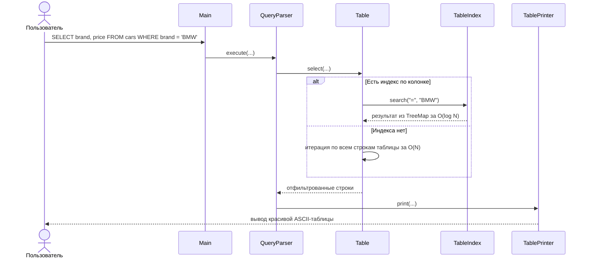

# Учебный проект: Консольная реляционная СУБД на Java

Курсовой/учебный проект по дисциплине «Базы данных» / «Объектно-ориентированное программирование».  
Представляет собой простую реляционную базу данных, написанную на чистой **Java 8+** без сторонних библиотек и фреймворков.

---

## Что умеет программа

- **Работа с таблицами (DDL):** создание таблиц (`CREATE TABLE`), удаление (`DROP TABLE`), создание индексов (`CREATE INDEX`).
- **Манипуляция данными (DML):**
  - Выборка `SELECT` с фильтрацией `WHERE` (поддерживаются `=`, `!=`, `>`, `<`, `>=`, `<=`);
  - Вставка `INSERT INTO` (включая множественную вставку нескольких строк через запятую `VALUES (1, '...'), (2, '...')`);
  - Обновление `UPDATE` и удаление `DELETE`.
- **Поддержка связей и целостности данных:**
  - `PRIMARY KEY` — проверка уникальности и запрет `NULL`;
  - `FOREIGN KEY` — проверка ссылочной целостности (нельзя добавить запись с внешним ключом, которого нет в родительской таблице).
- **Индексы для ускорения поиска:**
  - Реализованы на основе красно-чёрного дерева (`TreeMap`);
  - Быстрый точечный и диапазонный поиск за $O(\log N)$ вместо перебора всей таблицы $O(N)$.
- **Сохранение на диск:**
  - Данные сохраняются в бинарный файл `database.dat` через сериализацию Java;
  - Используется промежуточный файл `.tmp` с заменой через `Files.move`, чтобы данные не побились, если программа аварийно закроется при записи.
- **Интерактивная консоль:** режим командной строки с подсказкой `sql>` и форматированным табличным выводом в виде ASCII-сетки.

---

## Архитектура и структура классов

Проект разбит на логические классы внутри пакета `dbms`:

- `Main.java` — точка входа, консольный цикл ввода запросов (REPL) и бенчмарк.
- `QueryParser.java` — парсер SQL-запросов на регулярках, парсит команды и передает управление в методы таблиц.
- `Database.java` — контейнер всех таблиц базы (`Map<String, Table>`).
- `Table.java` — хранит список строк `List<Row>`, колонки, обрабатывает вставку/выборку/удаление и проверяет ключи. Реализует `Iterable<Row>`.
- `TableIndex.java` — индекс по колонке на основе `TreeMap<Comparable, List<Row>>`.
- `Column.java` — описание столбца (имя, тип, признаки PK и FK).
- `Row.java` — представление строки таблицы (`Map` колонка -> значение).
- `DataType.java` — типы данных (`INT`, `DOUBLE`, `STRING`, `DATE`, `BOOLEAN`) и их парсинг из строк.
- `DatabaseRepository.java` — сохранение и чтение базы с диска, создает дефолтные таблицы при первом запуске.
- `TablePrinter.java` — отрисовка красивой таблицы в терминале.

### Схема взаимодействия (Sequence Diagram)


---

## Структура папок

```text
java-dbms/
├── pom.xml                  # Конфиг сборки Maven
├── README.md                # Описание проекта
├── sample_queries.sql       # Тестовые SQL-запросы для проверки
├── run.bat                  # Быстрый запуск на Windows
├── run.sh                   # Быстрый запуск на Linux / Mac
├── .gitignore               # Игнор мусора компиляции и файлов БД
└── src/
    └── main/
        └── java/
            └── dbms/        # Исходники (10 классов)
```

---

## Как запустить

### Вариант 1: В VS Code (рекомендуемый)
1. Открыть папку `java-dbms` в VS Code (`File` -> `Open Folder`).
2. Открыть файл `src/main/java/dbms/Main.java`.
3. Нажать кнопку **Run** над методом `main` или нажать `F5`.

### Вариант 2: Через батник (Windows)
Просто запустить двойным кликом:
```cmd
run.bat
```

### Вариант 3: Ручная компиляция через консоль
```bash
# Компиляция
javac -encoding UTF-8 -d bin src/main/java/dbms/*.java

# Запуск
java -Dfile.encoding=UTF-8 -cp bin dbms.Main
```

### Вариант 4: Через Maven
```bash
mvn compile
mvn exec:java
```

---

## Примеры запросов для демонстрации

При первом запуске автоматически создаются таблицы производителей `brands` и машин `cars` (с внешним ключом `brand -> brands.name`).

```sql
-- Посмотреть стартовые данные
SELECT * FROM brands;
SELECT * FROM cars;

-- Вставить данные
INSERT INTO cars VALUES (1, 'Toyota', 25000.0, TRUE, '2026-11-10');
INSERT INTO cars (id, brand) VALUES (2, 'BMW');
INSERT INTO cars VALUES (3, 'Toyota', 18500.0, FALSE, '2026-11-12'), (4, 'Lada', 12000.0, TRUE, '2026-11-14');

-- Проверка внешнего ключа (выдаст ошибку, так как Ferrari нет в brands)
INSERT INTO cars VALUES (5, 'Ferrari', 200000.0, TRUE, '2026-11-14');

-- Выборка с фильтром
SELECT brand, price FROM cars WHERE price > 20000;

-- Обновление и удаление
UPDATE cars SET price = 30000 WHERE id = 2;
DELETE FROM cars WHERE brand = 'Toyota';

-- Создание индекса для ускорения поиска
CREATE INDEX idx_cars_brand ON cars (brand);
SELECT * FROM cars WHERE brand = 'BMW';

-- Создание новой таблицы
CREATE TABLE groups (id INT PRIMARY KEY, name STRING, course INT);
INSERT INTO groups VALUES (1, 'PI-21', 3);
SELECT * FROM groups;
DROP TABLE groups;

-- Запуск теста скорости индексов
BENCHMARK

-- Выход с сохранением базы
EXIT
```

---

## Тестирование производительности (Бенчмарк индексов)

В программе реализована команда `BENCHMARK`. Она генерирует временную таблицу на **50 000 строк** и делает **1 000 поисковых запросов** `SELECT` сначала полным перебором, а затем через индекс `TreeMap`.

### Результаты замера на моем компьютере:
- **Без индекса (линейный поиск $O(N)$):** ~1198 мс
- **С индексом (поиск по красно-чёрному дереву $O(\log N)$):** ~1 мс
- **Итог:** поиск с индексом отработал примерно в **1200 раз быстрее**.
